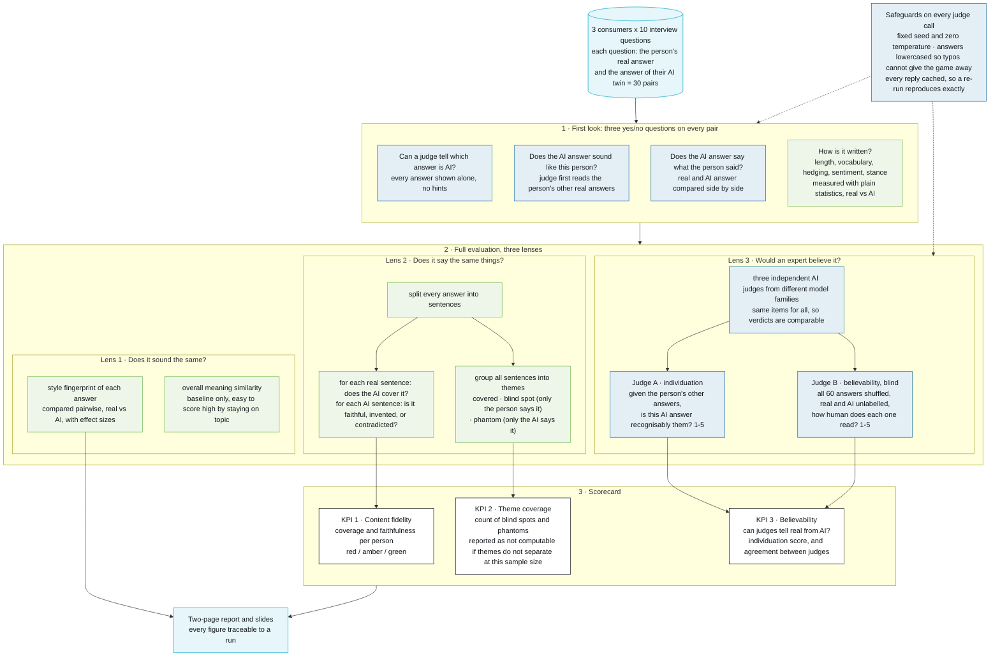

# Pipeline

The evaluation in one picture, at the level a reader with no code in front
of them needs. Blue steps ask an AI judge; green steps are plain statistics
or local language models; white boxes are the scorecard.

Also run, not on the chart: the first-look step was re-executed by
autonomous judge agents with full call logs, as an independent check that
the verdicts hold. For the file-level view of each step see the module
docstrings in `src/` and the entrypoints `run_eda.py`, `run_all.py`,
`run_plots.py`.
